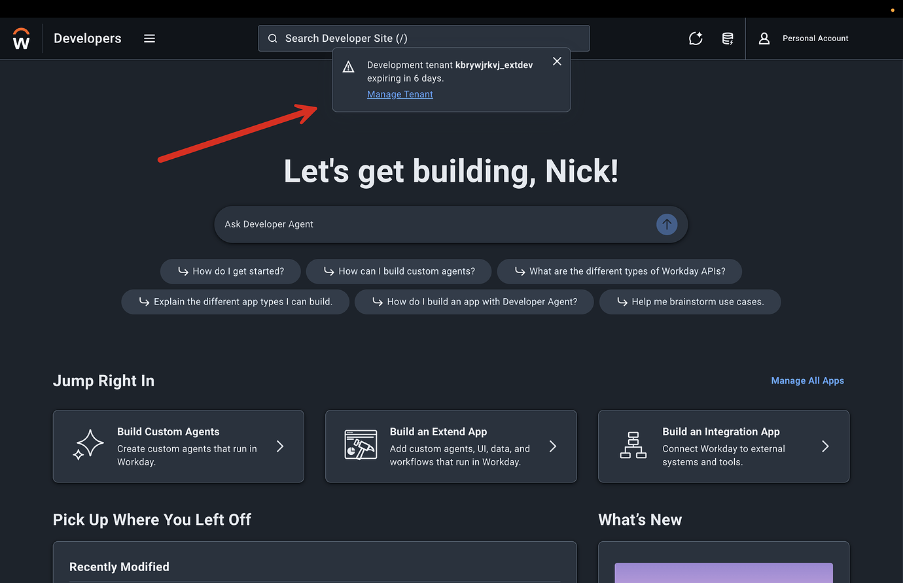
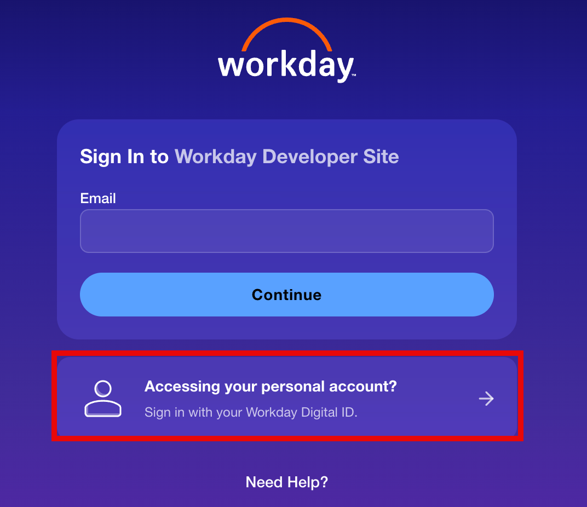

## Workday Developer Program FAQ

We have officially opened the Workday Developer Program, and we’re so excited for so many builders to join our community. We know you’ll have questions, from the nitty-gritty technical to which account to use when you log into your tenant. These are all good questions, and we welcome them. So, even before they’ve become frequently asked, here’s an FAQ addressing the ones we think you might have.

Don’t see your question? Reply to this thread and we’ll answer it and fold it into the FAQ.

### About the program
#### What is the Workday Developer Program?

The Workday Developer Program is Workday’s front door for builders: a single place to learn the platform, get hands-on access, and connect with the Workday developer community.

#### Does it cost anything?

No. The program is free!

#### Is the program open to the public?

Yes. It’s open to anyone who wants to create an account and build on the Workday platform. You don’t need to be a Workday customer or partner to join.

#### Is the program available in my region?

Yes, the Developer Program is available worldwide.

#### Should I sign up with my work email or a personal one?

If you’re a Workday customer or partner, we recommend signing up with a new, personal email rather than your work email.

#### How can I use it and get involved?

1. Create your personal account to sign up for the program.
2. Review the [program terms](https://developer.workday.com/terms/developerpersonalaccountterms) before you start.
3. Request a development tenant through the open access beta (see below).
4. Join the community here on the Developer Forum.

#### Where are the program terms?

The Workday Developer Program terms are published [here](https://developer.workday.com/terms/developerpersonalaccountterms). They govern use of the program, including development tenants, so please read them before requesting access.

#### What do I get access to as part of the program?

* **Development tenant** (via the open access beta; availability is limited, see below)
* **Developer documentation, APIs, and SDKs**
* **Learning content and training**
* **Developer community and forum**

### Getting a development tenant
#### What is the open access beta?

The open access beta is the part of the program where you can request the ability to create a Workday development tenant. If there is availability, you will automatically be approved for this capability and will be able to create a development tenant going forward.

It’s a beta, so availability is limited and tenants are deleted after a period of inactivity. See the tenant policy questions below for details.

#### What kind of tenant do I get?

You get a Next Level Enterprise (NLE) tenant, a new type of Workday tenant. It’s a test instance of Workday that includes some, but not all, of the users and setup you’d find in a traditional GMS tenant.

#### How do I get a development tenant?

1. Create your personal account and accept the program terms.
2. Open the hamburger menu in the top left of the Developer Site and select **Tenants** (or go directly to the [Tenants page](https://developer.workday.com/console/tenants)).
3. Create your tenant there. You request access when you first go to create it, and if there is availability, you’re approved automatically.
4. Your temporary tenant password is sent to the email address registered to your account. See “Which account should I use to log in to my tenant?” below.
5. If there is no availability, you don’t need to do anything else. A tenant will be granted to you when one becomes available.

### Development tenant policies
#### Can anyone get a tenant?

Approval is limited during the open access beta, so it depends on current availability. If there isn’t any when you request, a tenant will be granted to you when one becomes available.

#### How long does a development tenant last?

Any open developer tenant with no activity for 7 consecutive days is automatically and permanently deleted.

**Deletion is permanent. Please manually back up any critical work immediately.**

**How to keep your tenant active:** Your tenant stays active as long as you do at least one of the following each week:

* Log into the tenant directly.
* Generate authenticated API traffic (via OAuth clients, integrations, or agent calls).

**We don’t send a warning email before deletion.** You can see your tenant’s real-time status and exact expiration date at any time in the **Tenants** section of the Developer Site, while logged in with your personal account.

**What this means for you:**

* **Active users:** No action required. Keep building.
* **Inactive users who want to keep their tenant:** Log in or trigger API activity before your listed expiration date.
* **Inactive users who no longer need their tenant:** No action required. It will be deleted automatically after 7 days of inactivity.

#### What is the tenant extension policy?

There’s no separate extension process. See “How long does a development tenant last?” above for how to keep your tenant alive.

#### What is the purge policy?

Tenants with no activity for 7 consecutive days are automatically and permanently deleted. At this time, deletion cannot be undone, so please back up anything you want to keep. [Check the Tenants section of the Developer Site](https://developer.workday.com/console/tenants) for your tenant’s exact expiration date. It is also shown to you when you log in:

#### Can I have more than one tenant?

No, only one tenant per account at a time. You can always delete your tenant and create a new one.

#### Can I work in my tenant with a teammate?

Yes. We encourage everyone to create their own Personal Account, and if two or more people need to collaborate and build in the same tenant, they’re welcome to do so.

### Signing in and troubleshooting
#### Which password is which?

You’ll use two different logins, and they’re easy to mix up:

* **Your Workday Digital ID** gives you access to your Personal Account on the Developer Site and the Developer Forum, with more properties coming soon.
* **Your Workday tenant** is a test instance of Workday with pre-provisioned, fictitious accounts for demo purposes (`lmcneil`, `wd-implementer`, and others). Each of those accounts can have its own password.

If you can’t get into the Developer Site or the forum, that’s your Digital ID. If you can’t get into your tenant, that’s a tenant password. The reset steps for each are below.

#### I get an “access blocked” message. Is the program not available in my region?

You’ll see this screen when you log in with an existing Digital ID account in our system and still need to add a **Workday Build Personal Account Profile**. Your Workday Digital ID is used for various properties such as community or our events program, and now your Workday Build Personal account!

When you log in, you’ll be redirected to the digital Account Center, where you can add that profile. Once it’s added, select the profile and you’ll land in your personal account, ready to start building.

#### I already log in to the Developer Site with my work email. What do I do?

Sign out, then sign in with your personal credentials to reach your personal account. Make sure to use the option below **Accessing your personal account? Sign in with your Workday Digital ID.**

#### Can I create a personal account directly?

Yes, you can create one by visiting [this link](https://digital.workday.com/en-us/login.html?sso=opendev).

#### Which account should I use to log in to my tenant?

Your tenant comes with pre-provisioned, fictitious accounts for demo purposes. It includes some, but not all, of the usual users you’d find in a traditional GMS tenant. These two are the ones to start with:

* **`lmcneil`**: log in as the tenant admin (Logan McNeil)
* **`wd-implementer`**: log in as an implementer, who has even higher configuration permissions

Use the randomly generated password that was sent to the email address registered to your account. When you log in as a user, you’ll be asked to create a new password for that user. Each user can have its own password, and changing a password on the tenant sign-in page only changes it for that user (for example, `lmcneil`).

#### Why can’t I see certain functional areas in my tenant?

Not all functional areas are turned on by default. You can activate them and populate data by logging in as **`wd-implementer`**.

#### I forgot my tenant password. How do I reset it?

You can reset the passwords for all accounts in your tenant at once:

1. Log in to the Developer Site with your personal account and go to the [Tenants page](https://developer.workday.com/console/tenants).
2. Select your tenant. A panel opens on the right.
3. Click **Reset Password**.

A new tenant password is sent to your registered email, and **all accounts in the tenant are reset to that password**. The next time you log in as each user, you’ll be asked to choose a new password for that user, just like the first time.

**Heads up:** Because a reset changes every account’s password at once, anyone else using those accounts, such as teammates or integrations, will be locked out until they use the new password. If you’re working with others, let them know before you reset.

If you only need to change the password for one user, you can do that from the tenant sign-in page, but it only affects that user.

#### I forgot the password for my personal account (Workday Digital ID). How do I reset it?

This is the password you use to sign in to your personal account, not your tenant. Go to the [sign-in page](https://digital.workday.com/en-us/login.html?sso=opendev) and select **Trouble Signing In?**, or use the [Trouble Signing In page](https://digital.workday.com/content/unified-site/en-us/trouble-signing-in.html?sso=opendev) directly.